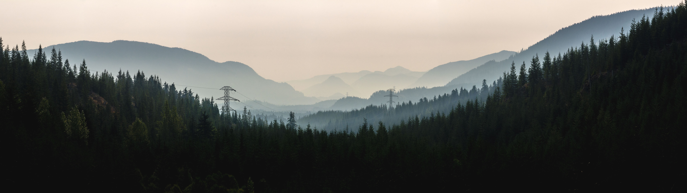
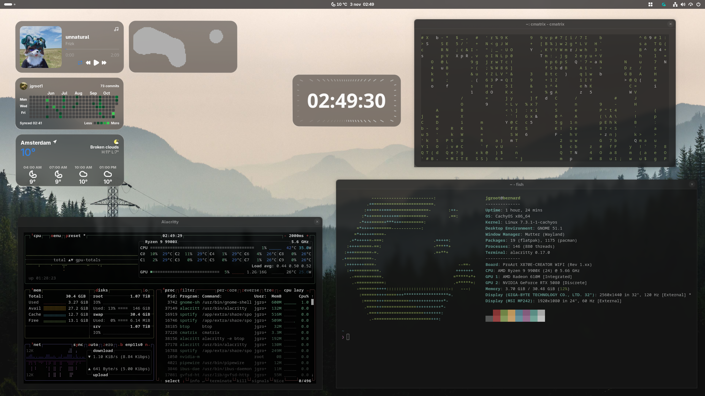
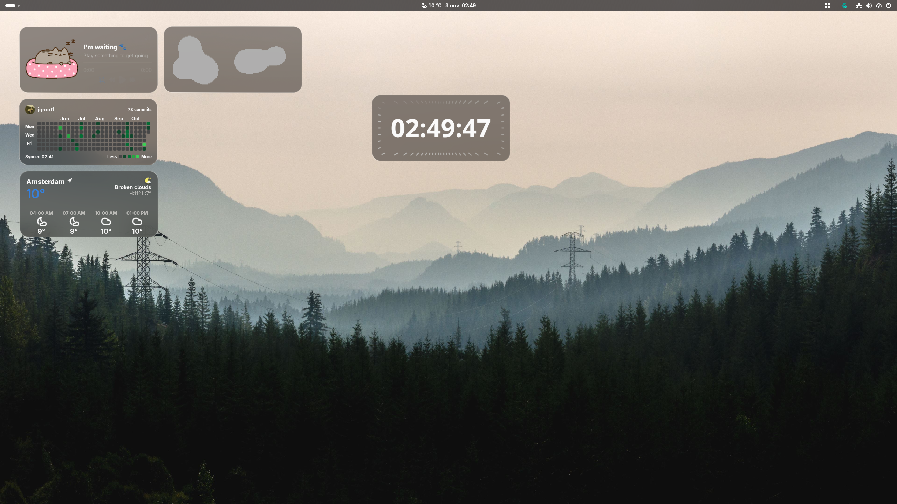

# Linux-customization
## my linux customizations/dotfiles

Distro: [cachyos](https://cachyos.org/)

Desktop environment: [gnome](https://www.gnome.org/)

Terminal: [alacritty](https://alacritty.org/)
Settings

# background 

# Gnome extensions:

[blur my shell](https://extensions.gnome.org/extension/3193/blur-my-shell/)

settingd

[just perfections](https://extensions.gnome.org/extension/3843/just-perfection/)

settingd

[app indicator](https://extensions.gnome.org/extension/615/appindicator-support/)
settints

[widgets](https://github.com/r3nhick/desktop-widgets)

settinhs

# Screenshots of my homescreen

amsterdam is not really my location

